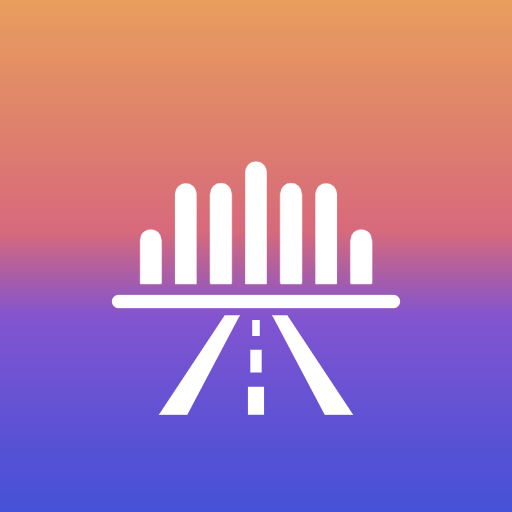
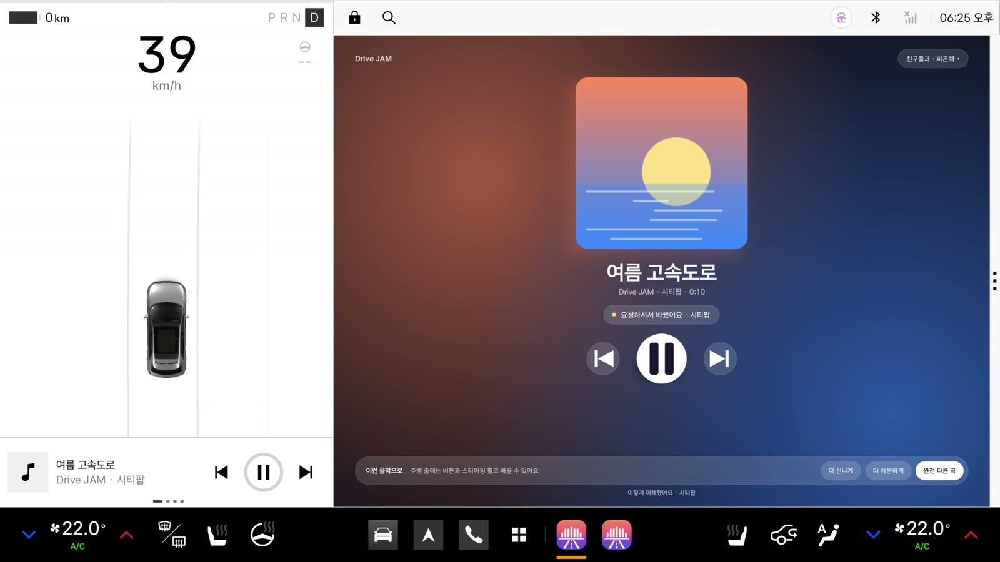
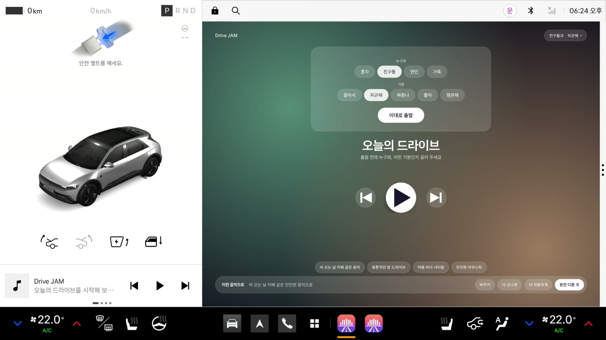
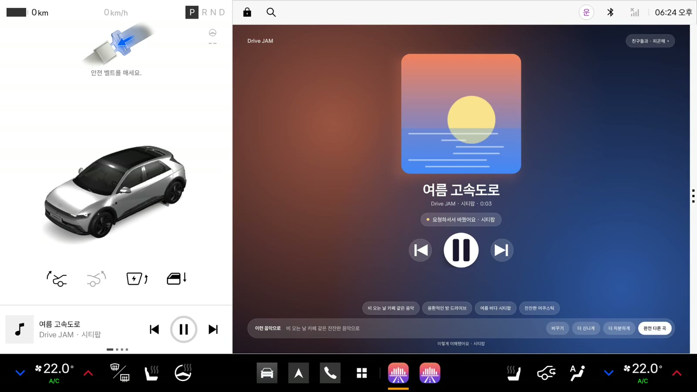
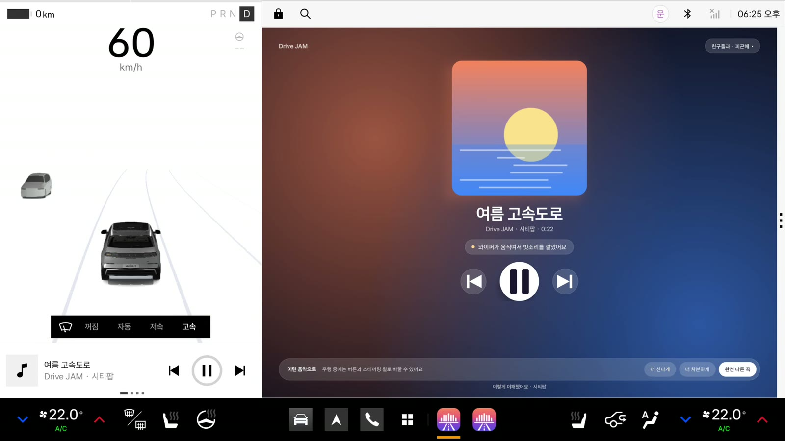
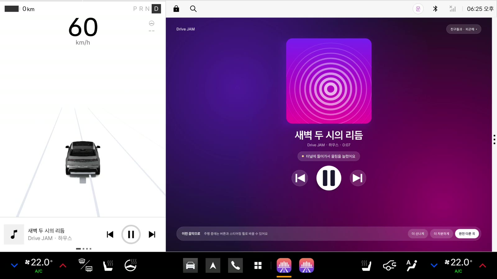
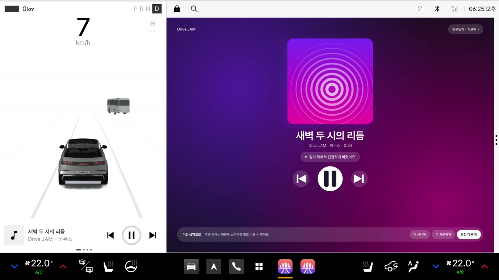
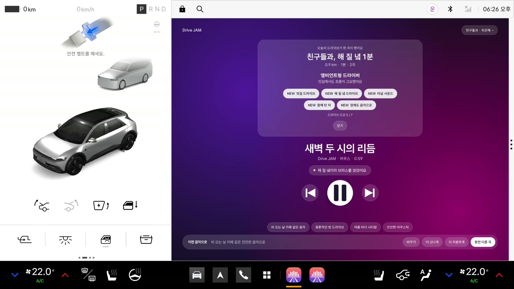
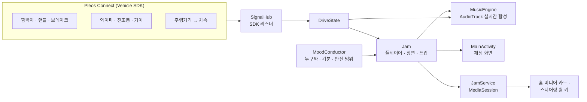

<div align="center">



# Drive JAM (드라이브 잼)

**내 운전이 그대로 음악이 됩니다.**<br>
깜빡이는 하이햇, 핸들은 필터, 급정거는 멈칫. 누구와 어떤 기분으로 가는지에 맞춰<br>
그 순간의 곡을 차와 함께 연주하는 Pleos Connect 차량 전용 음악 앱

`Pleos Connect` · `Android Automotive (API 34)` · `Kotlin` · `Vehicle SDK 2.3.2` · `실시간 음악 합성`

2026 현대자동차그룹 차량용 앱 개발 공모전 출품작 · 팀 **TKAW**

[**APK 내려받기**](apk/TKAW_DriveJAM_release.apk) · [**릴리스 (APK + 시연 영상)**](https://github.com/WAcAW9/drive-jam/releases/tag/v1.0.0)

</div>

<p align="center">
  
</p>

---

## 목차

1. [앱 소개](#1-앱-소개)
2. [APK 위치](#2-apk-위치)
3. [실행 방법](#3-실행-방법)
4. [테스트 환경 및 필요한 설정](#4-테스트-환경-및-필요한-설정)
5. [개발 에뮬레이터 버전과 화면 규격](#5-개발-에뮬레이터-버전과-화면-규격)
6. [주요 기능과 시연 화면](#6-주요-기능과-시연-화면)
7. [동작 원리](#7-동작-원리)
8. [프로젝트 구조](#8-프로젝트-구조)
9. [소스에서 빌드하기](#9-소스에서-빌드하기)

---

## 1. 앱 소개

| | |
|---|---|
| **앱 이름** | Drive JAM (드라이브 잼) |
| **한 줄 소개** | 차량 신호가 악기가 되어, 내 운전이 그대로 음악이 되는 차량 전용 생성 음악 앱 |
| **카테고리** | Music / Audio (`MediaBrowserService` + `MediaSession`) |
| **패키지** | `com.drivejam.app` · 버전 1.0.0 |

차에 타면 누군가는 DJ가 되어야 합니다. 운전자는 음악을 고를 수 없고, 플레이리스트는 지금 누가 탔는지, 비가 오는지, 길이 막히는지 모릅니다. Drive JAM은 **차만 아는 신호**(깜빡이, 핸들, 브레이크, 와이퍼, 전조등, 기어, 주행거리, 내비)로 곡을 고르고, 연주하고, 도착에 맞춰 끝냅니다.

- 녹음된 음원 없이 **앱 안에서 실시간으로 합성**합니다. 장르 6개(시티팝·하우스·로파이·신스웨이브·어쿠스틱·칠)와 가사 없는 3성부 백코러스.
- 플레이리스트를 대신하지 않습니다. 여럿이 떠드는 드라이브, 비 오는 밤, 지루한 고속도로처럼 **플레이리스트가 어색한 순간**을 맡습니다.

## 2. APK 위치

| 항목 | 위치 |
|---|---|
| **APK 파일** | [`apk/TKAW_DriveJAM_release.apk`](apk/TKAW_DriveJAM_release.apk) (release 빌드, 서명됨, 약 8 MB) |
| **GitHub Release** | [v1.0.0](https://github.com/WAcAW9/drive-jam/releases/tag/v1.0.0) (같은 APK + 시연 영상 `drive-jam-demo.mp4`) |

## 3. 실행 방법

### 3-1. 설치

Pleos Connect 에뮬레이터를 켠 상태에서:

```bash
adb install -r apk/TKAW_DriveJAM_release.apk
```

> 같은 패키지의 debug 빌드가 이미 설치되어 있으면 서명이 달라 설치가 거부됩니다. 먼저 `adb uninstall com.drivejam.app`을 실행하세요.

작업 표시줄(또는 앱 목록)의 **Drive JAM** 아이콘을 누르면 오른쪽 앱 영역에 열립니다.

### 3-2. 사용하기

1. **출발 전 (기어 P):** "누구와"(혼자 / 친구들 / 연인 / 가족)와 "기분"(알아서 / 피곤해 / 짜증나 / 좋아 / 평온해)을 하나씩 고르고 **이대로 출발**을 누릅니다.
2. **곡 바꾸기:** ⏭ 다른 장르의 새 곡 · ⏮ 직전 곡 · 왼쪽 **홈 미디어 카드**와 스티어링 휠 미디어 키도 같은 동작을 합니다.
3. **"~한 음악으로" 요청:** 주차 중에는 문장으로(예: "비 오는 날 카페 같은 잔잔한 음악으로"), 주행 중에는 버튼 세 개(더 신나게 / 더 차분하게 / 완전 다른 곡)로 요청합니다.
4. **운전하기:** Virtual Console에서 아래 신호를 바꾸면 음악이 바로 반응하고, 화면에 "깜빡이를 켜서 하이햇이 들어왔어요"처럼 이유가 한 줄로 나옵니다.
5. **도착 (기어 P):** 20초 넘게 달린 뒤 주차하면 그날의 드라이브가 **한 곡의 카드**(제목, 거리·시간·곡 수, 드라이버 카드, 도감 스탬프)로 남습니다.

### 3-3. Virtual Console로 신호 넣기

```bash
adb forward tcp:8088 tcp:8088
# 브라우저에서 http://127.0.0.1:8088/ 을 열어 둔 채로 조작합니다 (페이지가 닫혀 있으면 API가 503을 반환)
```

| 콘솔 항목 | 앱에서 일어나는 일 |
|---|---|
| Gear `Drive` / `Park` | 주행 / 주차 화면 전환, 주차 시 오늘의 드라이브 카드 |
| Turn Signal `Blink Left/Right` | 깜빡임에 맞춘 하이햇, 켜진 쪽으로 소리가 치우침 |
| Steering Angle | 필터가 열리고 돈 방향으로 소리가 이동 |
| Brake Pedal | 밟는 동안 메아리가 길어짐. 차속이 급감하면 곡이 '멈칫' |
| Wiper `Low` / `High` | 빗소리 레이어 (간헐 / 촘촘) |
| Exterior Lights `Low Beam` | 밤에는 차분하게, **낮에 켜면 터널**로 보고 잔향을 늘림 |
| Odometer (주행거리) | 거리 변화로 차속을 계산 → 템포, 정체 감지 |

> **차속 입력 팁:** 콘솔의 주행 시뮬레이션은 주행거리를 올리지 않습니다. Odometer 값을 직접 올리거나, 앱 왼쪽 위 **"Drive JAM"을 길게 눌러 개발자 보기**를 열고 **DEV 차속 슬라이더**를 쓰세요. 개발자 보기에는 무드 시각화와 모든 신호 상태가 함께 보입니다.

## 4. 테스트 환경 및 필요한 설정

| 항목 | 값 |
|---|---|
| 테스트 기기 | Pleos Connect Emulator v2.1.0 (AVD `Pleos Connect v2.1`) |
| OS | Android 14 (API 34), Automotive, system image `android-34/pleos_car_emulator/x86_64` |
| 에뮬레이터 바이너리 | Android Emulator 36.4.9, RAM 4 GB |
| 차량 신호 입력 | Pleos Connect Virtual Console (`adb forward tcp:8088 tcp:8088` → http://127.0.0.1:8088/) |
| 빌드 도구 | JDK 17, Android SDK 35, Gradle 8.11.1 (wrapper 포함), Kotlin |
| SDK | `ai.pleos.playground:Vehicle:2.3.2` (`https://nexus-playground.pleos.ai/repository/maven-releases/`, `settings.gradle.kts`에 등록되어 있어 별도 설정 없음) |

**권한** (설치 시 자동 부여, 에뮬레이터 기준)

| 권한 | 용도 |
|---|---|
| `pleos.car.permission.CAR_LIGHTS` | 방향지시등, 전조등 |
| `pleos.car.permission.CAR_DRIVE` | 조향각, 브레이크, 주행거리, 주행 모드, 기어 |
| `pleos.car.permission.CAR_WINDOWS` | 와이퍼 |

**알아 두면 좋은 점**

- 오디오 출력이 켜진 에뮬레이터에서 소리를 들을 수 있습니다. 내비 안내·Gleo 음성이 나오면 오디오 포커스 정책에 따라 음악이 줄거나 멈춥니다.
- 지원하지 않는 차량 신호는 해당 악기 레이어만 꺼지고 나머지는 그대로 동작합니다.
- 홈 미디어 카드에 곡이 보이도록 미디어 센터에 opt-in(`androidx.car.app.launchable`)되어 있습니다. 앱을 처음 설치한 직후 카드가 비어 있으면 에뮬레이터를 한 번 재부팅하세요.
- 사각지대 카메라: 깜빡이를 켜면 Pleos가 카메라 화면을 앱 위에 띄웁니다. 음악은 그대로 반응합니다.

## 5. 개발 에뮬레이터 버전과 화면 규격

| 항목 | 값 |
|---|---|
| 에뮬레이터 | **Pleos Connect Emulator v2.1.0** (Android 14 / API 34, Automotive) |
| 전체 화면 | **2560 × 1440 px, 160 dpi (mdpi)**, 가로 |
| 앱 영역 | 오른쪽 앱 패널 **약 1682 × 1210 px** (왼쪽 차량·홈 패널, 위 상태바, 아래 작업 표시줄 제외) |
| 주행 중 표시 | `distractionOptimized` 선언. 주행 중 화면은 정지된 커버·제목·재생 버튼과 버튼 세 개만 |

UI는 이 앱 영역(1682 × 1210)을 기준으로 코드로 배치했고, 세로가 부족하면 스크롤됩니다.

## 6. 주요 기능과 시연 화면

> 전체 흐름은 1분 55초 시연 영상(장면별 챕터 · 실시간 차량 신호 패널)에 담겨 있습니다: [Release v1.0.0](https://github.com/WAcAW9/drive-jam/releases/tag/v1.0.0)의 `drive-jam-demo.mp4`

<table>
  <tr>
    <td width="50%"></td>
    <td width="50%"></td>
  </tr>
  <tr>
    <td><b>출발 전 체크인</b><br>누구와, 어떤 기분인지 한 번 고르면 그 기분에 맞춰 천천히 시작해 이 드라이브의 분위기로 데려갑니다(동질성 원리).</td>
    <td><b>"~한 음악으로" 요청</b><br>"여름 바다 시티팝으로" → 장르가 완전히 바뀝니다. 앱 안의 사전이 문장을 장르와 분위기로 바꿉니다.</td>
  </tr>
  <tr>
    <td></td>
    <td></td>
  </tr>
  <tr>
    <td><b>차량 신호 = 악기</b><br>깜빡이는 하이햇, 핸들은 필터, 와이퍼는 빗소리. 버튼 대신 지금 소리가 왜 이런지 한 줄로 알려 줍니다.</td>
    <td><b>창밖과 길</b><br>낮에 전조등이 켜지면 터널로 보고 잔향을 늘립니다. 노을 무렵에는 브라스가 얹힙니다.</td>
  </tr>
  <tr>
    <td></td>
    <td></td>
  </tr>
  <tr>
    <td><b>정체 → 해소</b><br>막히면 드럼을 빼고 허밍만 남기고, 길이 뚫리면 리듬이 다시 들어옵니다.</td>
    <td><b>오늘의 드라이브 카드</b><br>주차하면 그날 주행이 한 곡이 됩니다. 드라이버 카드는 모두 칭찬이고, 도감은 속도가 아니라 '순간'(빗길·노을·터널·함께 탄 차…)을 모읍니다.</td>
  </tr>
</table>

### 기능 요약

| 영역 | 내용 |
|---|---|
| 라이브 잼 | 깜빡이·핸들·브레이크·와이퍼·전조등·주행 모드·차속이 하이햇·필터·잔향·빗소리·화성·템포를 실시간으로 바꿉니다 |
| 무드 컨덕터 | 누구와·기분·시간대·날씨로 목표 분위기를 정하고 천천히 이동. 템포와 에너지에는 상한(과속을 보상하지 않음) |
| 음악 플레이어 | 곡마다 생성한 커버와 제목, ⏮ ⏯ ⏭, 홈 미디어 카드·스티어링 휠 키, 넘긴 장르는 덜 나오게 학습 |
| 요청 | 주차 중 문장 입력, 주행 중 버튼 3개, MediaSession 검색(`onPlayFromSearch`) 연결 |
| 창밖과 길 | 해 질 녘 브라스, 터널 잔향, 정체 앰비언트, 해소 시 리듬 복귀 |
| 백코러스 | 포먼트 합성 3성부 코러스가 16개 음절(우·음·밥·워우·샤·라·예…)을 장르별 패턴으로. 가사가 없어 대화를 가리지 않음 |
| 오늘의 드라이브 | 주차 후 제목·통계·드라이버 카드·도감 스탬프 7종. 주행 기록에 속도는 남기지 않음 |
| 안전 | 주행 중 입력 최소화, 오디오 포커스 준수, 급제동·과속에 보상이나 벌점 없음 |

## 7. 동작 원리



- **SignalHub**만 Vehicle SDK를 만집니다. 차속 API가 없어 주행거리의 2초 구간 변화로 차속을 계산합니다.
- **MusicEngine**은 44.1 kHz 스테레오를 한 오디오 스레드에서 합성합니다. 808·909식 드럼, FM 일렉트릭 피아노, 카플러스-스트롱 기타, 톱니파 신스, 장르별 베이스, 곡 시드로 만든 멜로디, 포먼트 백코러스. 곡 구성은 인트로 · 벌스 · 코러스 · 브레이크로 흐르고, 분위기 변화는 마디 경계에서만 적용합니다.

## 8. 프로젝트 구조

```
app/src/main/java/com/drivejam/
  SignalHub.kt      Vehicle SDK 리스너 → DriveState (SDK를 만지는 유일한 곳)
  MoodConductor.kt  무드 좌표, 동승 모드 목표, 안전 범위, 장면 → 음악 파라미터 (순수 함수)
  Scenes.kt         일몰표, 터널·정체 판정, 오늘의 드라이브 카드와 도감 스탬프
  Jam.kt            플레이어 상태: 곡 선택, ⏮ ⏭, 요청, 취향 학습, 오디오 포커스, 트립 기록
  Track.kt          장르 프리셋 6개, 곡(장르·키·시드), 곡 고르기, 곡 구성
  Chorus.kt         백코러스 편곡 (구간·장르별 음절 패턴)
  MusicEngine.kt    AudioTrack 실시간 합성 엔진
  MusicRequest.kt   "~한 음악으로" 해석기
  JamService.kt     MediaBrowserService + MediaSession (홈 카드, 스티어링 휠 키, 음성 검색)
  CoverArt.kt       곡마다 생성하는 앨범 커버, 배경, 재생 버튼 아이콘
  MainActivity.kt   재생 화면 (앱 이름을 길게 누르면 개발자 보기)
app/src/test/       단위 테스트 21개 (무드, 요청 해석, 장면, 엔진 오프라인 렌더링)
apk/                제출용 release APK
demo/demo.py        시연 영상 자동 촬영 스크립트 (Virtual Console API + 화면 녹화 + 자막)
assets/             README 이미지 (앱 아이콘, 시연 화면)
```

## 9. 소스에서 빌드하기

```bash
./gradlew testDebugUnitTest      # 단위 테스트 21개 (엔진 렌더링 결과는 app/build/demo-audio/*.wav)
./gradlew assembleDebug          # app/build/outputs/apk/debug/app-debug.apk
./gradlew assembleRelease        # app/build/outputs/apk/release/app-release.apk
```

- release 서명은 Git에 올리지 않는 로컬 `keystore.properties`(`storeFile`, `storePassword`, `keyAlias`, `keyPassword`)에서 읽습니다. 파일이 없으면 debug 키로 서명해 설치 가능한 release APK를 만듭니다.
- 시연 영상 다시 찍기: debug 빌드를 설치하고 Virtual Console 페이지를 연 상태에서 `python demo/demo.py` (결과: `demo/out/drive-jam-demo.mp4`).

---

<div align="center">
<sub>Team TKAW · 2026 현대자동차그룹 차량용 앱 개발 공모전</sub>
</div>
